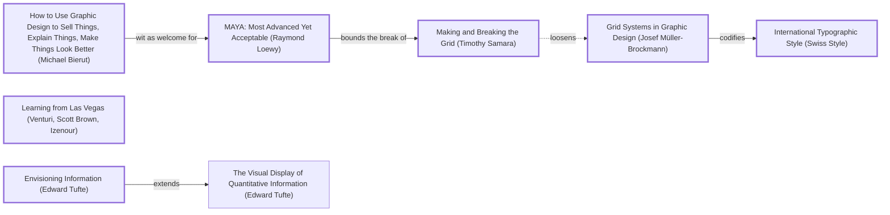

# FoodChart: DADA design log

Run started 2026-10-30. Legacy branch `legacy-2026-10-30` pushed at 7a4e144 before any change.

## 1. Traversal Plan

**Brief, restated.** Turn FoodChart, a repo of two overlapping JSON files about world cuisines with no page, into a reorganized, multi-page, deploy-ready static site whose data is clean enough to compare cuisines and whose home is the chart the name promises.

**Mode: Adaptive.** The work serves a public (curious cooks, students, anyone reusing the data). Governing criterion: MAYA, Most Advanced Yet Acceptable (Loewy). Both poles must hold for every move.

**Run type: Full.** A redesign of an inherited artifact; nothing frozen.

**Tooling inventory.**
| Job | Tool used |
|---|---|
| Render and navigate the anchor graph | none available as a renderer; Mermaid text below, labels grepped from `references/anchor-graph.md` |
| Compute the Frontier | by hand from the graph's edge lines |
| Track workflow state | the app's task list (`update_plan`) plus this log |
| Run the panel | Agent tool, one agent per reference, at most three at a time, each filing to `panel/<round>/<seat>.md` |
| Collect panel reports | listing `panel/<round>/` |
| Measure the artifact | the in-app browser (computed styles, geometry, contrast via script) and `_src/build.py` counts |
| Persist the log | this file |

**Seed (labels copied from the graph).**
- Stance: `How to Use Graphic Design to Sell Things, Explain Things, Make Things Look Better (Michael Bierut)`
- Rules: `Grid Systems in Graphic Design (Josef Müller-Brockmann)` -->|codifies| `International Typographic Style (Swiss Style)`
- Breaker: `Learning from Las Vegas (Venturi, Scott Brown, Izenour)`: the vernacular sign everyone can read; here the US Nutrition Facts label, détourned to describe a cuisine.
- Counterpoint (dotted): `Making and Breaking the Grid (Timothy Samara)` -.->|loosens| `Grid Systems in Graphic Design (Josef Müller-Brockmann)`
- Also reached: `Envisioning Information (Edward Tufte)` for the flavor matrix; `MAYA: Most Advanced Yet Acceptable (Raymond Loewy)` via `bierut -->|wit as welcome for| maya`.

**Chain.** Bierut -->|wit as welcome for| MAYA -->|bounds the break of| Making and Breaking the Grid -.->|loosens| Müller-Brockmann -->|codifies| Swiss Style; Critic: Provocateur (Debord) -->|answers orthodoxy with| Learning from Las Vegas.

**Panel (Adaptive, 7 seats, one agent per reference).** Critic: Provocateur (Debord), Critic: Provocateur (Shklovsky), Critic: Inclusion (Holmes), Critic: Inclusion (Mace), Critic: Usability (Krug), Critic: Evidence (Cairo), Critic: Cross-Cultural (Escobar). Dotted pair: `crit_prov_debord -.->|attacks smoothness favored by| crit_use_krug`.

**Bound (user rule: gm + faiku + dada must never stall).** At most 3 WHOLE rounds after R0; at most 3 ADAPT rounds on any move. Anything still open after that is logged as an open item, not chased.



## Premortem, round R0 (the inherited repo)

### Panel, WHOLE, round R0 (artifact examined: commit 7a4e144, evidence `panel/R0/EVIDENCE.md`)
| Critic | Anchor used | Observed in the work | Verdict | Requested change |
|---|---|---|---|---|
| Provocateur (Debord) | Society of the Spectacle, theses 1 and 4; détournement | "Famous dishes", "Popular dishes" placeholders; no sources; "Regional diversity" as an influence | OBJECT | Chart relations (influence flows, shared ingredients), show gaps instead of hiding them, give influences their history of power |
| Provocateur (Shklovsky) | Art as Technique: automatization | Stock adjectives ("Spicy flavors", "Rich sauces"); grouped "Spices (…)" | OBJECT | Let the chart defamiliarize: show unexpected kinship; atomic ingredients; plain navigation |
| Cross-Cultural (Escobar) | Designs for the Pluriverse (Arturo Escobar) | One schema for all; "Middle Eastern" lump; colonial history as flat tags; no African, Andean, Pacific cuisines | OBJECT | Add scope; give influences a kind (trade, conquest, migration); name who is missing; cite sources |
| Inclusion (Holmes) | Mismatch; persona spectrum | No interface; only JSON readers served; narrow canon | OBJECT | Text twin for every chart; plain labels; regions-not-covered note; correction path; README |
| Inclusion (Mace) | Perceptible information | No page; placeholders; inconsistent keys | OBJECT | Real tables with scope; skip link; focus ring ≥3:1; targets ≥44 px; no colour-only encoding |
| Usability (Krug) | Trunk test | No README; the signpost points at nothing; two overlapping files | OBJECT | Chart first on home; same nav everywhere; breadcrumbs; one data file; README |
| Evidence (Cairo) | How Charts Lie: denominator and procedure | Measured: ingredients 61 slots / 40 distinct, flavors 39/15, techniques 36/18; list lengths 4 to 6 per cuisine; bundles hide components | OBJECT | Caption states the denominator (12 chosen cuisines, not a sample), the procedure ("listed in N of 12"), that list lengths differ, and "curated, incomplete"; presence matrix, never world percentages; downloadable cleaned data |

Statements of meaning: every seat read the inherited repo as a flat list, for people who already know the subject and can read JSON, under a name that promises a chart.
Andon pulled: no.

## Frontier
| Candidate | Reached via | From anchor | Status |
|---|---|---|---|
| F1 No page, no README; one data file, one spelling | R0 Krug, Mace, Holmes | Don't Make Me Think (Steve Krug) | TAKEN (M1) |
| F2 Grouped and mis-filed data | R0 Shklovsky, Krug, Mace | Art as Technique (Viktor Shklovsky) | TAKEN (M1) |
| F3 The label as the design system | seed Breaker | Learning from Las Vegas (Venturi, Scott Brown, Izenour) | TAKEN (M2) |
| F4 Chart first on home | R0 Krug; seed | Envisioning Information (Edward Tufte) | TAKEN (M3) |
| F5 Show the gaps: unsourced facts, missing cuisines | R0 Debord, Escobar, Holmes | The Society of the Spectacle (Guy Debord) | TAKEN (M4) |
| F6 Influences as relations with a kind | R0 Debord, Escobar | Designs for the Pluriverse (Arturo Escobar) | TAKEN (M5) |
| F7 Scope on each label | R0 Escobar, Holmes | Designs for the Pluriverse (Arturo Escobar) | TAKEN (M5) |
| F8 Unexpected kinship across regions | R0 Shklovsky | Art as Technique (Viktor Shklovsky) | TAKEN (M6) |
| F9 Names in each cuisine's own language | R0 Escobar | Designs for the Pluriverse (Arturo Escobar) | DEFERRED (needs sourced, community-checked names; inventing transliterations would be the error the seat objects to) |
| F10 Dietary filter | R0 Holmes | Mismatch: How Inclusion Shapes Design (Kat Holmes) | DEFERRED (the data holds no dietary facts per dish; adding them is new research, logged as an open item) |
| F11 Sources for every fact | R0 Debord, Escobar, Cairo | How Charts Lie (Alberto Cairo) | DEFERRED as research; the gap itself is shown (M4) |
| F12 Dotted counterpoint: Samara loosens the grid | seed | Making and Breaking the Grid (Timothy Samara) | TAKEN (M2: the label breaks the page grid into a fixed narrow column) |
| F13 Chart caption: denominator, procedure, unequal list lengths, curated | R0 Cairo | How Charts Lie (Alberto Cairo) | TAKEN (M4) |

## 2. Decision Records

> Deviation: the records for M1 and M2 were written after those moves were made (the data file, generator and stylesheet were built while the R0 seats were still running). They are recorded in full; every later record precedes its move.

## Move M1: One cleaned data file, atomic items  (KEEP-THE-RULE)
Depends on: none
Anchors: Stance How to Use Graphic Design to Sell Things, Explain Things, Make Things Look Better (Michael Bierut) | Rule Grid Systems in Graphic Design (Josef Müller-Brockmann)
Intent: one source of truth the chart is computed from. Merge `Cuisines.json` (7) into the 12-cuisine detailed file; split grouped ingredients ("Spices (Turmeric, …)" into four); refile mis-filed items ("Regional diversity" out of influences; "Minimalist presentation" and "Seasonal ingredients" out of Japanese techniques into a new `principles` field; Vietnamese "Fresh preparation" to `principles`, technique "Rolling"); add `slug`, `region`, `summary`. Delete the two root JSON files; publish `site/data/cuisines.json`.
Formal argument: a chart can only compare like with like (the grid as a rule of comparable units); grouped and mis-filed entries make comparison impossible (R0 Shklovsky, Krug, Mace, Cairo).
Alternatives rejected: (a) keep both files and add a third: three sources of truth; (b) build from the files where they are: the misspelt name and mis-filed fields would be published as-is.
Consequence: old raw URLs stop working; the about page records where the data went. Japanese gains "Deep-frying" (tempura is its listed dish) and "Raw slicing" (sashimi): new facts, flagged here.
Fence: the old split offered a short and a detailed view; the short view is now the mini label.
Frontier effect: F5, F7, F8 become computable.
Mode field: Advanced pole: data shaped to be charted (Envisioning Information (Edward Tufte)). Acceptable pole: plain field names (Don't Make Me Think (Steve Krug)).

## Move M2: The Nutrition Facts label as the design system  (BREAK)
Depends on: M1
Anchors: Stance Bierut | Rule International Typographic Style (Swiss Style) | Breaker Learning from Las Vegas (Venturi, Scott Brown, Izenour) | Counterpoint Making and Breaking the Grid (Timothy Samara) (dotted edge from Grid Systems in Graphic Design (Josef Müller-Brockmann))
Intent: every cuisine is read as "Cuisine Facts": Franklin Gothic black, a 10 px bar between sections, hairlines between rows, a right-hand "Shared*" column where % Daily Value would be ("3 of 12"), and the footnote turned into the honesty note on what the count means. Header and footer reuse the bars.
Formal argument: the most-read piece of information design in the US is the box label; borrowing its vernacular (Venturi) makes a cuisine legible at once (acceptable pole); substituting culture for nutrients is the détournement (advanced pole). The label's fixed narrow column breaks the page grid (Samara).
Alternatives rejected: (a) a photo-led food magazine: images the project does not own, and the postcard R0 Debord objected to; (b) a periodic table of cuisines: implies an order the data does not have.
Consequence: strict monochrome; the tomato accent is reserved for links and the current page. The label invites a nutritional reading the footnote must refuse.
Fence: the Swiss grid exists so pages scan alike; every cuisine page keeps an identical label.
Frontier effect: F4; Mace's contrast and target checks.
Mode field: Advanced pole: Learning from Las Vegas, the détourned vernacular. Acceptable pole: MAYA, the form is already known.

## Move M3: The chart comes first on home  (KEEP-THE-RULE)
Depends on: M2
Anchors: Stance Bierut | Rule Envisioning Information (Edward Tufte)
Intent: measured before: hero 871 px tall, flavor chart top at y = 968 px, below the first screen. Shorten the hero to headline and one line, put the chart directly under it, and move the full label to a "How to read a label" section after the chart.
Formal argument: the name promises a chart (R0 Krug, Cairo); show the data first (Tufte).
Alternatives rejected: (a) shrink the hero label: it stops being readable; (b) chart in the hero's right column: 15 columns do not fit half a page.
Consequence: the label is no longer first on home; it still opens every cuisine page.
Fence: the hero label introduced the device; the new section keeps that job, after the evidence.
Frontier effect: none.
Mode field: Advanced pole: the chart as the front door. Acceptable pole: Krug's trunk test answered in one screen.

## Move M4: Show the gaps  (BREAK)
Depends on: M1, M2
Anchors: Breaker Learning from Las Vegas | Counterpoint The Society of the Spectacle (Guy Debord) (via Critic: Provocateur (Debord) -->|attacks the spectacle with|)
Intent: every label prints "Sources: none cited yet", linked to how to add one; the cuisines and about pages list the cuisines not on the chart yet; the chart caption states the denominator, procedure, unequal list lengths and that the twelve are a curated, incomplete choice (F13).
Formal argument: Debord asked that gaps be shown, not hidden; Cairo that a count state its denominator and procedure.
Alternatives rejected: (a) invent sources: fabrication; (b) omit silently: the spectacle R0 objected to.
Consequence: the site looks less finished; that is the cost.
Fence: a label omits what it cannot vouch for; here the omission is visible.
Frontier effect: F11 stays research.
Mode field: Advanced pole: a détourned label admitting its emptiness. Acceptable pole: a plain sentence and a link.

## Move M5: Influences with a kind; scope on each label  (KEEP-THE-RULE)
Depends on: M1
Anchors: Rule Grid Systems in Graphic Design (Josef Müller-Brockmann) | Counterpoint Critic: Cross-Cultural (Escobar)
Intent: each influence gets a kind: Roots, Trade and exchange, Migration, Empire and conquest, Colonial rule, Forced migration and enslavement. The influences page groups by kind; the label shows it. Each cuisine gets a `scope` row ("A family of national cuisines" for Middle Eastern; "Many regional cuisines" where the data says so).
Formal argument: "British" beside "Indian" with no verb hides power (R0 Debord, Escobar); one word of kind restores it without inventing dates.
Alternatives rejected: (a) dated timelines: new unsourced claims; (b) leave as tags: the objection stands.
Consequence: kinds are judgments; the about page says so and invites correction.
Fence: none broken.
Frontier effect: the influences page becomes a second chart.
Mode field: Advanced pole: the history of power on a food label. Acceptable pole: one plain word per influence.

## Move M6: Unexpected neighbors  (BREAK)
Depends on: M1, M3
Anchors: Breaker Learning from Las Vegas | Counterpoint Art as Technique (Viktor Shklovsky)
Intent: on home, the four pairs of cuisines from different regions that share the most items, with what they share, computed at build.
Formal argument: make the familiar strange (Shklovsky); kinship across regions is the surprise the chart can produce honestly.
Alternatives rejected: (a) a network of all 66 pairs: unreadable; (b) hand-picked pairs: not reproducible.
Consequence: the pairs change as cuisines are added; counts reward longer lists (Cairo), so the procedure is printed beside them.
Fence: none broken.
Frontier effect: none.
Mode field: Advanced pole: defamiliarized kinship. Acceptable pole: four sentences.


## 3. Panel Reports

### Panel, WHOLE, round R1  (artifact examined: site/ after M1 to M6; `panel/R1/EVIDENCE.md`, `home-desktop.jpg`, `vietnamese-phone.jpg`)
The first batch (Debord, Shklovsky, Escobar) filed; the session then restarted before the second and third batches launched. Holmes, Mace, Krug and Cairo did not sit R1: recorded as **NOT CONVENED in R1 (session restart)**, not as PASS. All seven sit R2 on the artifact after the R1 resolutions.

| Critic | Anchor used | Observed in the work | Verdict | Requested change |
|---|---|---|---|---|
| Provocateur (Debord) | détournement | Shared* where % DV sits; "Sources: None cited yet"; but "Spanish / Colonial rule" and "African / Forced migration and enslavement" set in the same rhythm as "Corn" | OBJECT (Shaped by block only) | Set the violent kinds apart on the label with a heavy rule and a sub-label |
| Provocateur (Shklovsky) | ostranenie vs automatization | "Unexpected neighbors" shows Greek and Middle Eastern (the expected Mediterranean pair) and generic taste words; "What sets it apart" sits below the label | OBJECT | Rank by concrete shared ingredients and techniques, drop adjacent regions; lift "what sets it apart" into the label |
| Cross-Cultural (Escobar) | the pluriverse; autonomous design | influences.html repeats "Chinese" under three kinds with the same four cuisines; "African" names a continent, not people; "Garlic is used in all twelve kitchens" stated as fact | OBJECT | List only the cuisines each kind applies to; name enslaved Africans; say who judged the kinds and that the template is the project's; soften the garlic line |

Statements of meaning: Debord: a site that prices cuisines like products and then shows its own blanks. Shklovsky: food as a catalogued, countable product of other people's power and trade, every count honestly the chart's own. Escobar: a modest, honest sketch by one outsider whose categories are borrowed.
Artist questions: none. Critic questions: Escobar asked who judged the kinds (answered in M7).
Andon pulled: no.

**Resolutions.** Debord: ADAPT M5 (M7). Escobar: premise measured on `site/influences.html`: the "Chinese" row under Migration listed Japanese, Korean, Thai and Vietnamese, while the data gives Migration only for Thai. Confirmed defect; ADAPT M5 (M7). Escobar's request to list each influence only once is OVERRULED: grouping by kind is the device Debord's seat credits with exposing power; the defect was the cuisines listed, not the grouping. Shklovsky: ADAPT M6 (M8). REOPENED: M5, M6.

## Move M7: Imposed influences set apart; kinds counted honestly  (BREAK, adapts M5)
Depends on: M5, M2
Anchors: Breaker Learning from Las Vegas (Venturi, Scott Brown, Izenour) | Counterpoint The Society of the Spectacle (Guy Debord) | Rule Grid Systems in Graphic Design (Josef Müller-Brockmann)
Intent: on every label, "Shaped by" splits in two: roots, trade and migration first; then a 5 px rule and the sub-head "Imposed" over empire and conquest, colonial rule, and forced migration and enslavement. On influences.html each kind lists only the cuisines it applies to, with that count. "African" becomes "Enslaved Africans". The influences page says who judged the kinds; about.html says the template and categories are this project's, not the cuisines' own; the garlic sentence no longer claims a fact about the world.
Formal argument: the label's equal rows flatten conquest into an ingredient (Debord); the label's own rules (bars between sections) can carry the break, so the vernacular is broken with its own grammar. A count that includes cuisines the kind does not apply to is false (Cairo's standing rule).
Alternatives rejected: (a) colour the imposed rows red: colour-only encoding (R0 Mace) and the accent means "link"; (b) drop kinds from the label: hides what R0 asked to show.
Consequence: labels gain one rule and one sub-head; the three cuisines whose listed influences include nothing imposed (French, Japanese, Thai) show no Imposed block.
Fence: the label's bar exists to separate kinds of fact; using it to separate kinds of history extends its job.
Frontier effect: none new.
Mode field: Advanced pole: the label's grammar broken where history breaks. Acceptable pole: one heavy rule and one plain word.

## Move M8: Neighbors far apart, by concrete items; what sets it apart on the label  (BREAK, adapts M6)
Depends on: M6, M2
Anchors: Counterpoint Art as Technique (Viktor Shklovsky) | Rule Envisioning Information (Edward Tufte)
Intent: rank pairs by shared ingredients and techniques only, excluding same and adjacent regions (Europe and West Asia; East and Southeast Asia; South and Southeast Asia; South and West Asia), keeping pairs with at least 2 concrete items; flavors shown but not counted. Measured preview: Mexican and Chinese (chili peppers, steaming), Mexican and Thai (chili peppers, grilling), Middle Eastern and Vietnamese (mint, grilling), Mexican and Vietnamese (lime, grilling). Retitle "Far apart, something in common". Add a "Sets it apart" row to the label from `principles`.
Formal argument: the surprise must come from the data, not the heading (Shklovsky); counting generic taste words inflates overlap (R0 Cairo: counts reward longer lists).
Alternatives rejected: (a) keep the heading and the old ranking: promises a shock and delivers a cliché; (b) hand-pick pairs: not reproducible.
Consequence: the pairs now share only two items each; the copy says so plainly.
Fence: none broken.
Frontier effect: none.
Mode field: Advanced pole: kitchens an ocean apart reaching for the same chili. Acceptable pole: two named items per pair.


### Panel, WHOLE, round R2  (artifact examined: site/ after M1 to M8; `panel/R2/EVIDENCE.md`, `mexican-label-desktop.jpg`, `far-apart-phone.jpg`)
All seven seats convened, in batches of three, each filing to `panel/R2/`.
| Critic | Anchor used | Observed in the work | Verdict | Requested change |
|---|---|---|---|---|
| Provocateur (Debord) | détournement; the spectacle's equivalence | Imposed block on mexican.html; "Enslaved Africans"; Sources row; residual: the aside "Shaped by" repeats the flat format | PASS | none |
| Provocateur (Shklovsky) | ostranenie | far-apart pairs now concrete ("mint and grilling"); "Sets it apart" in the label; residual: grilling (6 of 12) is near-automatic | PASS | none (optional: prefer pairs whose shared items are rarest) |
| Cross-Cultural (Escobar) | the pluriverse; autonomous design | all four R1 requests answered; "Whose categories these are" | PASS | none now (later: own names, present tense for living Indigenous cooks) |
| Inclusion (Holmes) | Mismatch; persona spectrum | table with words not colour; limits stated; F10 honestly deferred | PASS | none now (open: say no dietary data is held; enlarge two inline links) |
| Inclusion (Mace) | Perceptible information | landmarks, one h1, scoped table; **focus check: `:focus-visible` 3 px solid, 2 px offset, 6.18:1, no `outline:none`: PASS** | PASS | none now (later: sr-only "no" in empty cells; corner cell a th; footer links 44 px) |
| Usability (Krug) | trunk test | home, thai.html, ingredients.html pass; residual: duplicate "Shaped by" aside; "12 cuisines per chart" reads oddly | PASS | none (optional) |
| Evidence (Cairo) | recompute, do not trust | recomputed every printed figure from the data: 142 Shared counts, 45/13, most-shared lines, chart totals, about totals, "3 to 5 flavors", the 4 pairs: 0 mismatches | PASS | none (optional: state the pair rule on the page) |

Statements of meaning: a label worn to show a cuisine cannot be shelved like a product (Debord); counted overlaps and imposed debts without pretending to know more (Shklovsky); an outsider's sketch that says whose categories it uses (Escobar); limits stated so newcomers and screen-reader users are not mismatched (Holmes, Mace); a first-time visitor knows where they are (Krug); every count true to its file (Cairo).
Andon pulled: no. **S2 met at R2.** No ADAPT, SCRAP or REOPEN; optional requests enter the Frontier as F14 to F17.

| Candidate | Reached via | From anchor | Status |
|---|---|---|---|
| F14 Delete the duplicate "Shaped by" aside | R2 Debord, Krug | Less Is More (Ludwig Mies van der Rohe) | TAKEN (M9) |
| F15 Mace's later fixes; Holmes's dietary note and inline targets | R2 Mace, Holmes | The Principles of Universal Design (Ronald Mace et al.) | TAKEN (M9) |
| F16 Rank far-apart pairs by rarity, state the rule on the page | R2 Shklovsky, Cairo | Art as Technique (Viktor Shklovsky) | TAKEN (M10, the S4 push) |
| F17 Reword "12 cuisines per chart" | R2 Krug | Don't Make Me Think (Steve Krug) | DECLINED: it is the label's "servings per container" line, the détournement in miniature; MAYA's advanced pole keeps it, and Krug marked it optional |

## Move M9: Deletion and access polish  (KEEP-THE-RULE)
Depends on: M7, M8
Anchors: Rule Less Is More (Ludwig Mies van der Rohe) | Rule The Principles of Universal Design (Ronald Mace et al.)
Intent: delete the aside "Shaped by" list on cuisine pages (the label now carries influences with the Imposed split; the aside repeated them flat). Empty chart cells speak "no"; the chart's corner cell becomes a header naming the rows; footer links get 44 px targets; the two small inline links get padding to 24 px; about.html says no dietary or allergen information is held.
Formal argument: a second, flatter copy of the same facts undoes M7 (Debord) and costs a scan (Krug); the access fixes are Mace's perceptible-information principle applied where measured short.
Alternatives rejected: (a) keep the aside for its links to influences.html: move the links into the label rows instead; (b) leave the empty cells silent: a screen reader hears nothing for "no".
Consequence: cuisine pages shorten; influence names in the label become links.
Fence: the aside existed to link each influence to its index row; the label rows take that job.
Frontier effect: none.
Mode field: Advanced pole: the label alone carries the history. Acceptable pole: every cell and link reachable.
Residual diff to measure: aside removed; label influence rows link to `influences.html#<name>-<kind>`; empty cells contain sr-only "no"; footer link height; the two inline link heights.

## Move M10: Rarity decides who is far apart  (BREAK, the S4 ambition push on M8)
Depends on: M8
Anchors: Counterpoint Art as Technique (Viktor Shklovsky) | Breaker Learning from Las Vegas (Venturi, Scott Brown, Izenour)
Intent: rank non-adjacent pairs by the rarity of what they share (each shared ingredient or technique weighs 1 / the number of cuisines listing it), ties broken by the rarest item; allow a single shared item; print each item's count and the rule on the page. Measured preview: Mexican and Chinese (chili peppers 3, steaming 3), Mexican and Vietnamese (lime 2, grilling 6), Middle Eastern and Vietnamese (mint 2, grilling 6), Indian and Greek (yogurt 2). Mexican and Thai (chili 3, grilling 6) drops out.
Formal argument: the most-shared technique (grilling, 6 of 12) is the least surprising thing two kitchens can share; weighting by rarity makes the chart do the defamiliarizing (Shklovsky) and prints the procedure beside the result (Cairo).
Alternatives rejected: (a) keep count-based ranking: grilling props up three of four pairs; (b) drop grilling outright: an arbitrary rule.
Consequence: a pair can now rest on one item; the copy says so.
Fence: none broken.
Frontier effect: none.
Mode field: Advanced pole: yogurt linking Indian and Greek kitchens. Acceptable pole: each item printed with its count.


### Panel, WHOLE, round R3  (artifact examined: site/ after M1 to M10; `panel/R3/EVIDENCE.md`, `mexican-label-R3.jpg`)
All seven seats convened. Drive E: filled up mid-round: Holmes's and Krug's files failed and Mace's was left empty (ENOSPC). Each seat had returned its full text; the caller saved that text verbatim to `panel/R3/<seat>.md` once space was freed, with a note at the top of each file. Cairo ran after space was freed and filed normally.
| Critic | Anchor used | Observed in the work | Verdict | Requested change |
|---|---|---|---|---|
| Provocateur (Debord) | détournement | Imposed block holds; duplicate list gone; rarity weighting stops treating shared items as equal | PASS | none |
| Provocateur (Shklovsky) | ostranenie; laying bare the device | rule printed beside the pairs; Greek and Indian over yogurt; Mexican and Thai gone; grilling marked as common by its count | PASS | none |
| Cross-Cultural (Escobar) | the pluriverse | wording holds; pairs claim only overlap | PASS | none (after research: own names, present tense) |
| Inclusion (Holmes) | Mismatch | both R2 open items closed; reasons for pairings stated | PASS | none |
| Inclusion (Mace) | Perceptible information | corner th, "no" in empty cells, 44 px footer links; **focus check: 3 px, 2 px offset, 6.18:1, 0 suppressions: PASS** | PASS | none |
| Usability (Krug) | trunk test | one linked influence list; rule in plain words; declined item a fair trade | PASS | none |
| Evidence (Cairo) | reproducible ranking | 142 Shared counts, pair counts, totals all match; top 3 pairs reproduce; the 4th was chosen from a 3-way tie the page did not state | PASS | none required (optional: state the tie) |

Andon pulled: no. Cairo's optional item taken as M11 (an honesty fix to a displayed figure; no new device).

## Move M11: State the tie at the cut-off  (KEEP-THE-RULE)
> Deviation: this record was written after the edit, which was made directly on Cairo's R3 finding.
Depends on: M10
Anchors: Rule Envisioning Information (Edward Tufte) | Critic: Evidence (Cairo)
Intent: when pairs below the cut-off score the same as the last pair shown, the page names them and states the tie-break (rarest shared item, then alphabetical). Result: "Spanish and Japanese, seafood (2 of 12); Mexican and Thai, chili peppers (3 of 12) and grilling (6 of 12)".
Formal argument: four pairs printed as a ranking implies they beat the rest; with a three-way tie that is not true unless the tie is shown.
Alternatives rejected: (a) show five or six pairs: the cut-off just moves; (b) say nothing: the overstatement Cairo measured.
Consequence: one hint line under the pairs.
Residual diff: home page gains one `p.hint`; pair list unchanged; all 25 displayed figures re-measured below, 0 mismatches.
Mode field: Advanced pole: a ranking that admits its ties. Acceptable pole: one sentence.

## 2f. Deletion review and residual diffs

Elements that predate the run, and what each earned:
| Element | Earns | Decision |
|---|---|---|
| `Cuisines.json` (7 cuisines, 21 one-line traits) | nothing the detailed file lacks: its 7 cuisines and influences are a subset; 3 of 21 traits were placeholders | SCRAPPED (M1). Retained value: its one meaningful traits ("Use of corn", "Rich sauces", "Vegetarian dishes", "Regional variations") moved into `principles` and `scope` |
| `DetailedCusines.json` | the content: 12 cuisines, dishes, ingredients, flavors, techniques, influences | KEPT as content, merged into `_src/data/cuisines.json`; the misspelt file SCRAPPED. Originals on `legacy-2026-10-30` |
| `LICENSE` (MIT) | the data's licence, now stated on the site and in the Dataset JSON-LD | KEPT |
| `CONTRIBUTING.md` | contribution path; its pointer to a missing README | KEPT, pointer fixed |

Deletions inside the run, with residual diffs:
- M3: hero label removed from the first screen. Residual: chart heading y 968 → 386 px (intended); label moved to "How to read a label" (intended).
- M8 then M9: the aside "What sets it apart" and the aside "Shaped by" deleted. Residual: cuisine pages shorter (intended); influence links moved into label rows, 3 links on mexican.html (intended); no inert or regressed value found (0 overflow at 375 px on every page checked, focus ring unchanged).

## 2g. Final-state figures (measured after the last edit, M11)

Procedure: `python _src/build.py`, then recount from `_src/data/cuisines.json` with `collections.Counter` over each field and compare with the text of `site/*.html` (the script is in this run's transcript; every figure below is reproducible that way).
| Printed figure | Where | Value at final state | Result |
|---|---|---|---|
| 45 ingredients, 13 in more than one cuisine | home | 45, 13 | reproducible |
| entries list 3 to 5 flavors | chart caption | 3 to 5 | reproducible |
| lime 2 of 12, grilling 6 | home rule text | 2, 6 | reproducible |
| most shared: Garlic 4, Savory 7, Grilling 6, Chinese 4 | index pages | 4, 7, 6, 4 | reproducible |
| 48 dishes, 45 ingredients, 15 flavors, 18 techniques, 28 influences | about, og.png | same | reproducible |
| Shared "N of 12" on every label row | 12 cuisine pages | 142 of 142 correct | reproducible |
| pair and tie-note item counts (lime 2, mint 2, chili peppers 3, steaming 3, yogurt 2, seafood 2, grilling 6) | home | same | reproducible |
| chart bottom-row totals 7 5 4 3 3 3 3 2 2 2 1 1 1 1 1 | home, flavors | same (Cairo, R3) | reproducible |
25 checks, 0 mismatches. No figure drifted; none corrected.

## Anchor Ledger
| Anchor | Role | Status | Evidence | Note |
|---|---|---|---|---|
| How to Use Graphic Design to Sell Things, Explain Things, Make Things Look Better (Michael Bierut) | Stance | KEEP | the site explains before it decorates: chart first, label explained | survived R0 Krug ("work it out yourself") |
| MAYA: Most Advanced Yet Acceptable (Raymond Loewy) | governing criterion | KEEP | every record names both poles | survived R1 Shklovsky (cliché pairs): answered by M8, M10 |
| Grid Systems in Graphic Design (Josef Müller-Brockmann) | Rule | KEEP | identical label on every cuisine page; facet tables share columns | survived R0 Escobar (one schema for all): stated as the project's frame |
| International Typographic Style (Swiss Style) | Rule | KEEP | Franklin Gothic, flush-left, bars and hairlines | |
| Learning from Las Vegas (Venturi, Scott Brown, Izenour) | Breaker | KEEP | the Nutrition Facts label as the vernacular | survived R1 Debord (conquest read as an ingredient): ADAPTED in M7 |
| Making and Breaking the Grid (Timothy Samara) | Counterpoint (dotted to Müller-Brockmann) | KEEP | the label's fixed narrow column breaks the page grid | |
| Envisioning Information (Edward Tufte) | Expression | KEEP | the flavor matrix; chart first | survived R0 Cairo (counts reward long lists): caption states it |
| Art as Technique (Viktor Shklovsky) | Counterpoint (critic edge) | KEEP | M8, M10 | |
| The Society of the Spectacle (Guy Debord) | Counterpoint (critic edge) | KEEP | M4, M7 | |
| Less Is More (Ludwig Mies van der Rohe) | Rule | KEEP | M9 deletions | |
| The Principles of Universal Design (Ronald Mace et al.) | Rule | KEEP | M9 | |
| Don't Make Me Think (Steve Krug) | Welcome | KEEP | trunk test passed R2, R3 | |
| How Charts Lie (Alberto Cairo) | Lens | KEEP | M4, M11; 2g | |

Live graph: no renderer available; final classes:
```mermaid
graph LR
  classDef kept stroke-width:3px
  class bierut,maya,mb,itstyle,venturi2,samBreak,tufteE,shklovsky,debord,mies,mace,krug,cairoLie kept
```

## Frontier (final)
F1 to F8, F12, F13: TAKEN (M1 to M6). F14, F15: TAKEN (M9). F16: TAKEN (M10). Cairo R3 tie: TAKEN (M11). F9 own-language names: DEFERRED (needs sourced, community-checked research). F10 dietary filter: DEFERRED (no dietary data; the about page now says so). F11 sources: DEFERRED as research; the gap is printed on every label. F17 reword the brand line: DECLINED with reason. **No OPEN items.**

## 4. Stop test
- **S1 met.** No OPEN Frontier items (above).
- **S2 met.** R2 and R3: every required seat PASS, no Andon.
- **S3 NOT met.** It needs two consecutive WHOLE rounds with no ADAPT, SCRAP, REOPEN or new Frontier item. R2 opened F14 to F17; R3 was quiet except Cairo's optional tie item, taken as M11. The run had a fixed bound of 3 WHOLE rounds after R0 (the user's standing rule that dada must not loop); it reached the bound with one quiet round and one optional item. Logged as an open item, not chased.
- **S4 met.** The push: M10 escalated M8's pairs. Measured change: the shown set went from {Mexican–Chinese, Mexican–Thai, Mexican–Vietnamese, Middle Eastern–Vietnamese} to {Mexican–Vietnamese, Middle Eastern–Vietnamese, Mexican–Chinese, Greek–Indian}; each item now prints its count. It survived R3 (7 PASS).
- **S5 met.** Dotted edges from used anchors: `samBreak -.->|loosens| mb` applied (M2); `maya -.->|tempers strangeness of| shklovsky` applied (the overlap caveats in M8, M10); `crit_prov_debord -.->|attacks smoothness favored by| crit_use_krug` applied as the panel's dotted pair; `bierut -.->|wit lineage from| sideways` declined: the label's wit already carries the stance and a second wit device would compete with it; `venturi2 -.->|decorated shed answers| sullivan` declined: the label is a decorated shed by construction, the counterpoint adds nothing here; `scher -.->` not used (Scher not visited).
- 2g run after the last edit (M11): 25 checks, 0 mismatches.

**Result: S1, S2, S4, S5 met; S3 not met (bounded stop). The run closes under the user's bound, not under full saturation.**

## 5. Double loop
The criterion held: MAYA forced every move to name both poles, and the strongest moves (M7, M10) came from a provocation seat whose request had to pass the acceptable pole too. The panel did not fail the work, but it was lopsided at R1 when a session restart left four seats unconvened; the protocol recorded it rather than filling it. The graph did fail one way: it has no node for the honesty of an *index*, as against a chart. Two defects of this run (the influences page counting every cuisine under every kind, and duplicate ids) were errors of cross-indexing that no anchor named; Cairo caught one only because it was asked to recount. **Graph amendments:** add a Rules node for faceted classification (Ranganathan, *Colon Classification*) with an edge `-->|cross-indexes honestly for|` to `How Charts Lie (Alberto Cairo)`, so a run that builds index pages reaches it. Carry-forward facts are in `CARRY-FORWARD.md`.

## 6. Compliance Check
- [x] Tooling inventory done; tool for each job, or "none available" (§1)
- [x] Mode stated with the reason: Adaptive (§1)
- [x] Seed with exact labels, one dotted-edge counterpoint, a living Frontier (§1, Frontier tables)
- [x] Run type stated: Full; nothing frozen (§1)
- [x] BREAK moves taken: M2, M4, M6, M7, M8, M10; no quota used as a stopping rule (the stop was the stated round bound)
- [~] Decision Record before each move: yes for M3 to M10; M1, M2 and M11 were written after their moves, recorded as deviations
- [x] Panel Report per round, mode composition met, every critic citing something observable (R0 to R3); R1 incomplete (4 seats not convened after a restart), recorded as such
- [x] Every OBJECT resolved: R0 all into moves; R1 Debord ADAPT (M7), Escobar ADAPT plus one OVERRULE with reason, Shklovsky ADAPT (M8); dependents M5, M6 reopened
- [~] WHOLE rounds run; S1, S2, S4, S5 met; S3 not met (bounded) (§4)
- [x] Every displayed figure re-measured at the final state, with the procedure (§2g)
- [x] Anchor Ledger complete; graph classes recorded as text (no renderer)
- [x] Double-loop paragraph written (§5)
- [ ] Final reply states mode, tools, stop conditions and everything skipped (in the reply)
